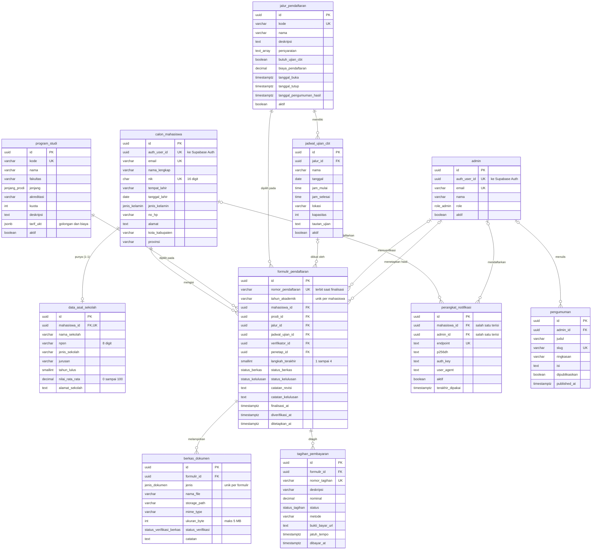

# ERD dan Dokumentasi Skema Database

Sistem Penerimaan Mahasiswa Baru (PMB). Database: PostgreSQL (Supabase), diakses lewat Prisma.
Sumber kebenaran skema: `prisma/schema.prisma`. Constraint tambahan: `prisma/constraints.sql`.

Catatan: kolom `created_at` dan `updated_at` ada di setiap tabel tetapi tidak digambar agar diagram tetap terbaca.

## Diagram

## Fungsi tiap tabel

| Tabel | Fungsi |
|---|---|
| `calon_mahasiswa` | Profil pendaftar. Terhubung ke akun Supabase Auth lewat `auth_user_id`. |
| `data_asal_sekolah` | Data sekolah asal, relasi 1-1 dengan pendaftar. |
| `program_studi` | Master program studi, termasuk kuota dan tarif UKT per golongan (JSON). |
| `jalur_pendaftaran` | Master jalur: persyaratan, biaya, periode buka dan tutup, tanggal pengumuman hasil, serta penanda butuh ujian CBT. |
| `formulir_pendaftaran` | Transaksi inti. Menyimpan pilihan prodi dan jalur, status berkas, status kelulusan, catatan revisi, nomor pendaftaran, dan admin pemroses. |
| `berkas_dokumen` | Metadata berkas yang diunggah (file asli di Supabase Storage privat). |
| `jadwal_ujian_cbt` | Sesi ujian CBT per jalur. |
| `tagihan_pembayaran` | Tagihan biaya pendaftaran per formulir. |
| `admin` | Akun panitia beserta peran (`SUPER_ADMIN`, `VERIFIKATOR`, `PANITIA`). |
| `perangkat_notifikasi` | Subscription Web Push milik pendaftar atau admin. |
| `pengumuman` | Pengumuman yang dikelola admin dan tampil di halaman publik. |

## Relasi penting

- Satu pendaftar punya paling banyak satu `data_asal_sekolah`.
- Satu pendaftar hanya boleh punya satu formulir per tahun akademik (unik pada `mahasiswa_id` + `tahun_akademik`).
- `formulir_pendaftaran` menunjuk dua kali ke `admin`: `verifikator_id` (yang memeriksa berkas) dan `penetap_id` (yang menetapkan hasil).
- Satu formulir hanya boleh punya satu berkas per jenis dokumen (unik pada `formulir_id` + `jenis`).
- Satu baris `perangkat_notifikasi` dimiliki tepat satu pihak: pendaftar atau admin.
- Menghapus pendaftar menghapus formulir, berkas, tagihan, dan perangkat notifikasinya (`ON DELETE CASCADE`). Prodi dan jalur yang sudah dipakai formulir tidak bisa dihapus (`RESTRICT`).

## Constraint tingkat database (validasi lapis 3)

- NIK 16 digit, nomor HP format Indonesia, NPSN 8 digit, nilai rata-rata 0 sampai 100.
- Periode jalur valid: `tanggal_tutup > tanggal_buka`, pengumuman hasil tidak sebelum penutupan.
- Status `REVISI` wajib disertai catatan.
- Formulir yang sudah dikirim wajib punya nomor pendaftaran dan waktu finalisasi.
- Hasil seleksi hanya boleh ditetapkan setelah berkas `TERVERIFIKASI`.
- Berkas maksimal 5 MB, hanya PDF, JPG, atau PNG.
- Trigger: pengiriman pertama formulir ditolak di luar periode jalur.
- Trigger: penetapan `LULUS` ditolak bila kuota prodi penuh (baris prodi dikunci agar aman dari race condition).
- Row Level Security aktif di semua tabel; akses data hanya lewat server.

## Nilai enum

| Enum | Nilai |
|---|---|
| `status_berkas` | DRAFT, DIKIRIM, DALAM_REVIEW, REVISI, TERVERIFIKASI |
| `status_kelulusan` | BELUM_DITETAPKAN, LULUS, CADANGAN, TIDAK_LULUS |
| `jenis_dokumen` | PAS_FOTO, KTP_KK, IJAZAH_SKL, RAPOR, SURAT_KETERANGAN_PENGHASILAN, DOKUMEN_PENDUKUNG |
| `status_verifikasi_berkas` | MENUNGGU, VALID, REVISI |
| `status_tagihan` | BELUM_BAYAR, MENUNGGU_KONFIRMASI, LUNAS, KEDALUWARSA, DIBATALKAN |
| `role_admin` | SUPER_ADMIN, VERIFIKATOR, PANITIA |
| `jenjang_prodi` | D3, D4, S1 |
| `jenis_kelamin` | LAKI_LAKI, PEREMPUAN |